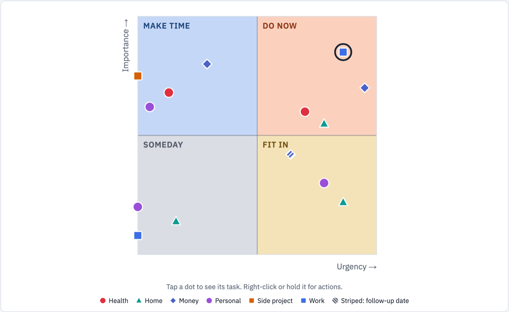
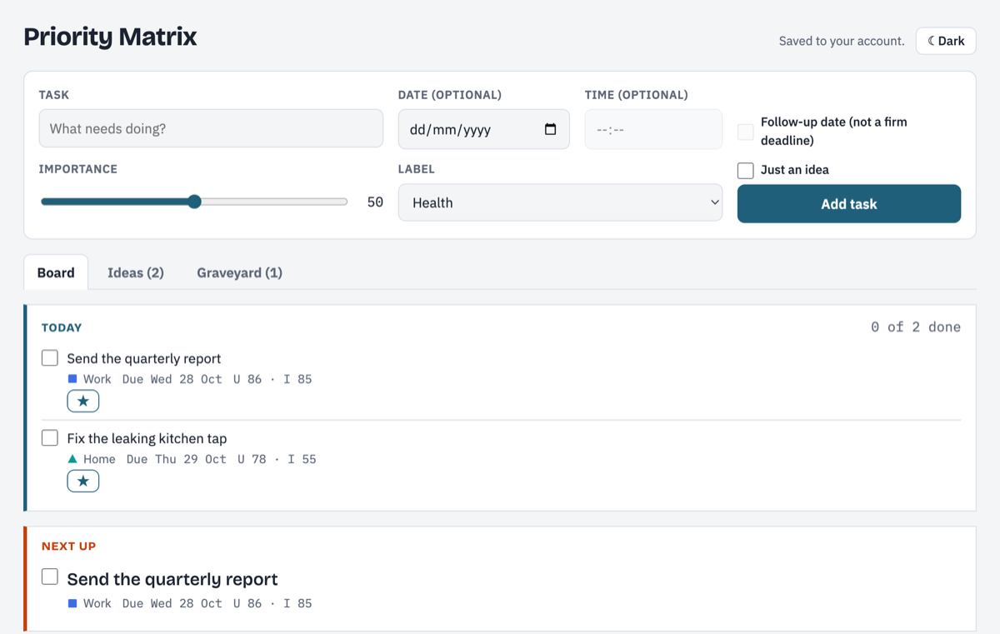
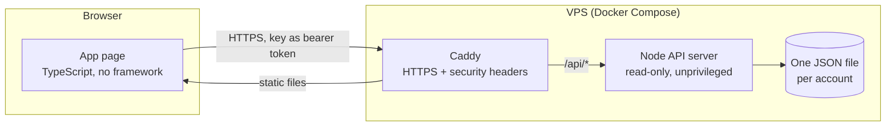

<div align="center">

# Priority Matrix

**What should I work on right now?** One glance, one answer.

Capture every task from every part of your life, score how much it matters, give it a date, and see it land in the right quadrant of an Eisenhower matrix. The app keeps track of urgency for you as deadlines get closer.

[](https://github.com/coldlight-labs/priority-matrix/actions/workflows/ci.yml)


[](LICENSE)

<picture>
  <source media="(prefers-color-scheme: dark)" srcset="docs/images/matrix-dark.png">
  
</picture>

</div>

---

## Why

To-do lists treat every task the same. A long list hides the one thing that matters today, and everything that is not due yet quietly slips until it becomes an emergency.

Priority Matrix puts every task on two axes:

| | **Urgent** (due soon) | **Not urgent** |
| --- | --- | --- |
| **Important** | 🟧 **Do now**: do these first | 🟦 **Make time**: plan these before they turn urgent |
| **Less important** | 🟨 **Fit in**: quick wins, or hand them off | ⬜ **Someday**: maybe later, maybe never |

The names suggest what to do. They never decide for you.

## How it works

- **Importance is yours.** A slider from 0 to 100 when you capture the task.
- **Urgency is the app's job.** Give a task a date (and optionally a time) and urgency rises on its own as the day gets closer: `urgency = 100 × 2^(−days left / 7)`. A task due in a week sits at 50, one due tomorrow near 90, and an overdue one at 100. No date means urgency 0. You never have to re-score anything ([ADR 0002](docs/adr/0002-urgency-from-a-date.md)).
- **The line is at 50** on both axes. 50 counts as high.
- **Next up** is the open task in *Do now* with the highest urgency plus importance, with ties going to the more important one. It is the answer to "what now?".
- **Follow-up dates** are for "check back on this", not deadlines. They show as striped marks.

<picture>
  <source media="(prefers-color-scheme: dark)" srcset="docs/images/board-dark.png">
  
</picture>

## Features

**Capture and plan**
- Quick capture: text, optional date and time, follow-up tickbox, importance slider and a label.
- **Today**: star up to five tasks for today and watch the progress fill up. Picks end at midnight on their own.
- **Ideas**: a "Just an idea" tickbox parks a thought without cluttering the board. Turn it into a task later.

**See and act**
- The matrix draws every open task as a mark in its label's color *and* shape, so it still reads in grayscale or for color-blind eyes. 15 colors, each with a fixed shape.
- Tap a mark to see its task. Right-click or long-press for a menu: **done**, **today**, **edit**, **drop**.
- When marks overlap, the app lists the tasks under your finger so you can pick the right one.
- The same tasks also appear as a list grouped by quadrant, in priority order.

**Keep it tidy**
- Labels such as Work, Home, Health or Money: create, rename, recolor, archive and restore. Archived labels keep their tasks.
- **Graveyard**: dropped tasks go here. Revive them, or delete them for good after a confirmation.
- Light and dark themes, following your device by default.

**Your data stays yours**
- **Export CSV** for spreadsheets and **Full backup (JSON)** for everything. Spreadsheet formulas in task text are neutralized, so a task can't run anything when opened in Excel.
- Changes made on one device show up on your other devices within seconds.
- Two devices editing the same task at the same moment can't overwrite each other: the second save is refused with a clear message.

## Two ways to run it

**1. Self-hosted (current).** A small Node server and the Caddy web server, run with Docker Compose on a VPS.
- **No login page.** Each person gets one secret link, `https://<your-site>/#key=…`. Opening it once on a device is all it takes.
- **Separate accounts.** Each account's tasks live in their own file and are invisible to every other account.
- Accounts are managed from the server's command line only (`create`, `list`, `revoke`). There is no admin page to attack.
- Setup, updates and rollback: [`docs/hosting.md`](docs/hosting.md) and [ADR 0003](docs/adr/0003-self-host-on-vps.md).

**2. As a claude.ai artifact (where it started).** The same app, built as a private page inside claude.ai, using its built-in database ([ADR 0001](docs/adr/0001-artifact-database-storage.md)).

The app picks its storage by where it runs: the server in the site build, the artifact database inside claude.ai, and memory everywhere else (for local preview and tests).

## Security and privacy

<details>
<summary><b>How the secret links work</b></summary>

- A key is 32 random bytes (256 bits). It sits after the `#` in the link, and browsers never send that part to a server, so it does not appear in any log.
- The app keeps the key in that browser, removes it from the address bar (so it doesn't end up in screenshots), and sends it with every API call.
- The server stores only a SHA-256 hash of each key and compares it in constant time. The account always comes from the key, never from anything else in the request.
- A leaked link can be revoked at once, and a new one created.

</details>

<details>
<summary><b>Limits and hardening</b></summary>

- Every document is checked by the same core validation the app uses. Ids are restricted to letters, digits and dashes.
- Limits: 64 KB per request, 5,000 tasks and 200 labels per account, 300 requests per minute per address and per account, and 10 wrong keys per minute per address.
- Only Caddy is reachable from the internet. The API server runs as an unprivileged user with a read-only filesystem and no extra Linux capabilities.
- HTTPS everywhere with HSTS, a strict Content Security Policy (only the site's own scripts), `X-Frame-Options: DENY`, `nosniff`, `no-referrer` and a locked-down `Permissions-Policy`.
- User text is only ever rendered as text. `innerHTML` and its relatives are blocked by a lint rule.
- Logs hold one line per request (time, account id, route, status, duration), never keys, task text or IP addresses.

</details>

<details>
<summary><b>What is stored</b></summary>

- **On the server:** your tasks and labels, in one JSON file per account. No email, no name beyond the account label, no tracking, no analytics, and no cookies.
- **In your browser:** the account key, your light or dark choice, and the last open tab.
- The data folder is not encrypted at rest on the VPS disk. The files are readable only by the server's own user.

</details>

## Architecture

A **modular monolith**: one deployable, one folder per feature, a pure core in the middle, and dependencies that only point inward.



```
src/
  core/        Task and label rules: urgency, quadrants, Next up, validation. Imports nothing.
  features/    capture · matrix · tasks-list · shelf (Ideas, Graveyard) · labels · export
  ui/          Small shared page pieces (label marks, date fields, sliders)
  adapters/    Storage (memory, claude.ai database, HTTP server) and downloads
  app/         Entry point: picks the adapters and wires the features together
server/        The self-hosted API. Uses core's rules and Node's built-in modules only
deploy/        Dockerfile, compose.yaml, Caddyfile, update.sh
```

**The boundaries are enforced by tooling, not just documented.** [dependency-cruiser](.dependency-cruiser.cjs) fails the build when a feature imports another feature, core imports anything outside itself, or the server pulls in a package. A test proves each rule fires. Details: [`docs/architecture.md`](docs/architecture.md).

**Zero runtime dependencies.** The app and the server use only TypeScript, the browser and Node's built-in modules. Every development tool is pinned to an exact version.

## Getting started

You need Node 24.

```bash
npm ci
npm run dev        # the app with in-memory storage, at http://localhost:5173
```

To try the full setup locally (API server and app with two made-up test accounts):

```bash
npm run dev:server # API at http://localhost:8787
npm run dev:site   # app at http://localhost:5174
```

Then open `http://localhost:5174/#key=<key>` with a key from [`dev/dev-accounts.json`](dev/dev-accounts.json). These keys are fake and only work locally.

Before opening a pull request:

```bash
npm run check      # format, lint, types, import rules, tests and all three builds
```

## How it was built

Built with AI assistance (Claude Code) under a strict engineering process:

- **Plan before code.** Every change starts as an issue with a written plan: problem, approach, affected files, how it will be verified, and the risks.
- **Decisions are written down** as Architecture Decision Records in [`docs/adr/`](docs/adr/).
- **Strict checks on every commit:** TypeScript strict mode, `typescript-eslint` strict type-checked rules, Prettier, the import rules and a secret scanner run as pre-commit hooks. CI runs those plus the full test suite and all builds on every pull request.
- **Bug fixes start with a failing test.**
- **Architecture review** every three features, kept in [`docs/architecture.md`](docs/architecture.md).

## Stack

| | |
| --- | --- |
| Language | TypeScript 6 (strict) |
| Build | Vite 8 |
| Tests | Vitest 5 with happy-dom |
| Quality | ESLint (strict type-checked), Prettier, dependency-cruiser, pre-commit |
| Server | Node 24, built-in modules only |
| Hosting | Docker Compose, Caddy 2 (automatic HTTPS with Let's Encrypt) |

## Roadmap

- Nightly backups of the server data, kept for 30 days.
- Ideas being considered: a movable quadrant line, and optional AI suggestions for scores.

## License

[MIT](LICENSE) © Coldlight Labs. Use it, change it, share it.
