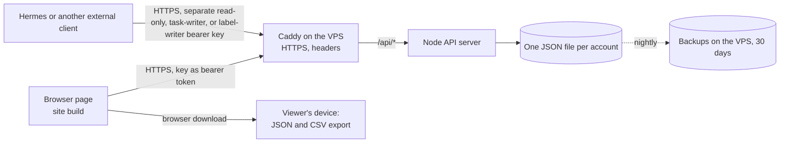

# Architecture: Priority Matrix

Tier: tool · Last reviewed: 2026-10-27 (review 6, after the self-hosting steps #62 to #77) · Features merged since review: 0

This file is the current shape of the system. Update it in the same pull request as any structural change. Source: `docs/plan.md` section 6.

## System map

Live: the site build on the VPS (ADR 0003, #66, #71), one secret link per account; nightly backups (#77). The API supports separately revocable read-only keys (ADR 0004, #7) and task-writer keys (ADR 0005, #9; ADR 0007). Task-writer keys can create and checked-update tasks, create labels, and checked-update existing labels; they cannot read account data or permanently delete tasks. The legacy create-only label-writer role remains supported for existing keys. No client key is configured by this change. The claude.ai artifact (ADR 0001) was retired on 2026-10-27 (#80); its build and adapter stay in the code, and the rows below marked "artifact" apply only to that build.

Local development and tests use an in-memory storage adapter in place of the artifact database (ADR 0001). Inside claude.ai without a database, the page shows a warning and refuses every save instead (review #12).

## Trust boundaries
Each row gets a threat check (six questions in the skill's `security.md`) before it is built.

| Boundary | Data crossing | Authentication | Authorization | Validation | Logged | Threat check |
| --- | --- | --- | --- | --- | --- | --- |
| User input to app | Task text, date, time, follow-up flag, importance, label choice, pick for today, idea or task | claude.ai session | Single user | `core`: text 1 to 500 chars, importance integer 0 to 100, date a real YYYY-MM-DD or empty, time HH:MM only with a date, follow-up boolean only with a date, label exists and is active; render with `textContent` only (ESLint-enforced) | No | 2026-10-23 (#15) |
| Artifact database to app | Stored tasks and labels, loaded once and then as live updates (#28) | claude.ai session | Artifact access | Validate every loaded or live-delivered document the same way; skip and log invalid ones; `schemaVersion` per document type (labels 1 or 2 (version 1 colors moved to the 15-color palette on read, #45), tasks 1 to 4; older tasks upgraded on read: version 1 per ADR 0002, versions 1 and 2 with no pick for today (#38), versions 1 to 3 only open or done (#42)); parsed tasks are rebuilt field by field | Invalid documents, to console | 2026-10-23 (#15) |
| App to artifact database | Task and label writes; task-save leases and the label-names lease in `locks` (#34, #56) | claude.ai session | `db` rules: `tasks` and `labels` readable at `view`, writable by `owner` only; revisit before sharing | Validated in `core` before write | No | 2026-10-22 (plan) |
| Internet to app server (ADR 0003, #62; deployed with #66) | Task and label documents, the checked saves, reads of an account's data | Secret key per account (256 bits) as a bearer token; only its SHA-256 hash stored; constant-time compare; revoked keys refused at once | The account comes from the key only; one data file per account; no admin endpoints over HTTP (account command over SSH) | Every document checked with `core`'s parsers and its id matched to the path; ids letters, digits and dashes only; body at most 64 KB; at most 5,000 tasks and 200 labels per account; 300 requests per minute per address and per account, 10 wrong keys per minute per address | One JSON line per request: time, account id, route, status, duration; never keys, task text or addresses | 2026-10-27 (ADR 0003) |
| Read-only external client to app server (ADR 0004, #7; available after deploy) | Full task and label data for the key's account through `GET /api/data` | Separate 256-bit bearer key; only its SHA-256 hash stored; constant-time compare; key can be revoked separately | Server permits only explicitly read-enabled routes; currently only `GET /api/data`; no account id is accepted from the client | Same response validation, body/rate limits and per-account scoping as the full key; endpoint returns all tasks and labels for that account | Existing request log records account id, route, status and duration; never keys, task text or addresses | 2026-10-28 (ADR 0004) |
| Task-writer client to app server (ADR 0005, #9; ADR 0007) | Task creation and checked task updates; label creation and checked label updates | Separate 256-bit bearer key per Hermes profile; only its SHA-256 hash stored; constant-time compare; key can be revoked separately | Server permits task and label writer routes only; denies reads, account administration, unrestricted upserts and permanent task deletion; account comes from the key | Task and label documents pass core parsers; edits compare the loaded record with current storage; label names remain unique; body/rate limits and per-account storage queue apply | Existing request log records account id, route, status and duration; never keys or task/label text | 2026-10-29 (ADR 0007) |
| Legacy label-writer client to app server (ADR 0006, #11) | One label name through `POST /api/labels/:id/create-if-name-free` | Existing separately revocable 256-bit bearer key; only its SHA-256 hash stored | Retained as create-only for compatibility; cannot read, write tasks, or manage existing labels | Existing core name validation, uniqueness, id, limit and rate checks remain | Existing request log omits keys and label names | 2026-10-29 (ADR 0007) |
| App server to app (site build, #64) | Account data and answers to saves | Bearer key on every call | Server-side, per account | Every task and label checked with `core`'s parsers, invalid ones skipped; server errors mapped to the app's messages; calls time out after 15 s | No | 2026-10-27 (ADR 0003) |
| Browser storage to app | Light or dark choice (`priority-matrix-theme`), the open tab (`priority-matrix-tab`, #42) and, in the site build, the account key (`priority-matrix-key`, #64), this browser only | None (same browser) | Single user | Only `light` or `dark` is used, else the device setting (`src/app/theme.ts`); a key is used only if it has the key format (`src/app/key.ts`); only `board`, `ideas` or `graveyard`, else the board (`src/app/tabs.ts`); blocked storage falls back the same way | No | 2026-10-25 (review) |
| App to viewer device (export) | JSON and CSV files (CSV includes date, time, follow-up, today and calculated urgency columns) | Viewer grants `downloads` | Single user | CSV cells starting with `=`, `+`, `-`, `@`, tab or carriage return prefixed with a single quote; cells with quotes, commas or line breaks quoted (RFC 4180) | No | 2026-10-24 (review) |

## Data stores

| Store | Holds personal data? | Region | Retention | Encrypted at rest |
| --- | --- | --- | --- | --- |
| Retired 2026-10-27, deleted by the owner (#80): claude.ai artifact database (`tasks`, `labels`; `locks` holds one lease document per edited task id and one `label-names` lease, no task or label content, #34, #56) | No by design; free text may mention people or companies | Anthropic-hosted | Until deleted for good in the Graveyard (#54) or the artifact is deleted; a deleted task's lease document in `locks` stays (no content, expires on its own) | Provider-managed |
| App server data folder on the VPS (`accounts.json` with names and full/read-only/task-writer/label-writer key hashes and metadata; `accounts/<id>.json` per account; ADR 0003, #62; deployed with #66) | Task text may mention people (testers too); labels may contain personal context | the VPS | Until the task or label is removed in the app, or the account's file is deleted on request; revoked key metadata remains; a revoked account's file stays until deleted | Not encrypted at rest (VPS disk); files readable only by the server's `node` user inside a Docker volume |
| Backups on the VPS (`/var/backups/priority-matrix/data-<date>.tar.gz`, #77) | Same as the data folder: every account's tasks and labels, testers' too | The owner's VPS | 30 days, one file per night; restores take a safety backup first | Not encrypted; folder and files readable by root only. The provider's weekly whole-VPS backups (two kept) hold copies too |
| Browser local storage (theme choice #23, open tab #42, account key in the site build #64) | No; the key gives access to that account | Viewer's device | Until the browser's site data is cleared | Browser-managed |

## Module map
Which module may import which is enforced by `.dependency-cruiser.cjs` (`npm run imports`), and `test/import-rules.test.ts` proves each rule fires.

| Module | Responsibility | Public interface | May import |
| --- | --- | --- | --- |
| `src/app` | Entry point: picks adapters (server in the site build `npm run build:site` with the key from the person's link, `key.ts`, #64; artifact db inside claude.ai; memory elsewhere), seeds labels, holds state, scores tasks and re-renders features (also every 15 minutes and when the page is shown again); light and dark toggle (`theme.ts`, choice kept in this browser); Board, Ideas and Graveyard tabs (`tabs.ts`, tab kept in this browser, #42); page styles | n/a | everything |
| `src/adapters/storage` | `TaskRepository` and `LabelRepository` implementations: memory (dev, tests), artifact-db (production; collections `tasks`, `labels`) unavailable (refuses saves) and server (the owner's server over HTTP with the account key, polling every 5 s while visible, #64); each can `watch` a collection (artifact-db: one live subscription per collection, #28; deliveries not yet confirmed by the server are skipped, #30); task saves from the list, and deletes from the Graveyard (#54), are checked under a short lease on `locks/<task id>` (#34); label name changes are checked under one lease on `locks/label-names` (#56) | Implements interfaces owned by `core` | `core`, `adapters/runtime` |
| `src/adapters/runtime.ts` | Minimal `window.claude` types (runtime contract 0.2.89) and `useCapability` | `useCapability`, runtime types | nothing internal |
| `src/adapters/downloads` | Wraps `claude.use("downloads")` as a `FileSaver`; `browser.ts` downloads through a temporary link on the owner's site (#64) | Implements an interface owned by `core` | `core`, `adapters/runtime` |
| `src/features/capture` | Quick-capture box: text, optional date, time and follow-up tickbox, importance slider, label picker, "Just an idea" tickbox (#42) | `src/features/capture/index.ts` | `core` |
| `src/features/labels` | Label manager: create, rename, recolor (15 colors, each with a fixed shape, #45), archive, restore; name changes (create, rename, restore) go through the checked save, which re-reads labels and checks the name under the label-names lease (i44, #56) | `src/features/labels/index.ts` | `core` |
| `src/features/tasks-list` | Today card (`today.ts`: up to 5 picks a day, progress, celebration, #38); Next up card; open tasks grouped by quadrant in priority order with their date line; done (asks "Mark as done?" first, i72) and reopen, refused when the task changed on another device or is being saved there (#20, #34); star to pick for today; Drop sends a task to the Graveyard (#42); inline Edit form in `edit-form.ts` (holds redraws while open); its handle also takes the dot menu's actions (`markDone`, `toggleToday`, `edit`, `drop`, #46) | `src/features/tasks-list/index.ts` | `core` |
| `src/features/shelf` | One list view used twice (#42): Ideas (newest first; Make it a task, Drop) and Graveyard (most recently dropped first; Revive; Delete for good, asked first, #54), saved and deleted through the checked save and checked delete | `src/features/shelf/index.ts` | `core` |
| `src/features/matrix` | SVG grid of open tasks, dots in label colors (striped for follow-up dates), ringed Next up, legend; SVG pieces built in `draw.ts` (#52); caption card with the label name in its color; dot menu (`dot-menu.ts`, #46: right-click, long press or menu key) that only reports the chosen action through `onAction`; dots that touch first list their tasks to pick from (#50) | `src/features/matrix/index.ts` | `core` |
| `src/features/export` | Builds JSON and CSV from repository data; Export CSV button offers the CSV, Full backup button the JSON (#40), each through `FileSaver` | `src/features/export/index.ts` | `core` |
| `src/ui` | Small page pieces shared by features (review 3, #44): the label mark in its color and shape (`labelDot`, `labelHex`, `labelShape`, `markShape`, #45), the form error line, and the date, time and follow-up controls and importance slider used by capture and the Edit form (`dateFields`, `scoreSlider`, #58) | `src/ui/index.ts` | `core` |
| `src/core` | Task and Label types, urgency from a date and scored tasks (ADR 0002), quadrant rule, next-up rule and the shared priority order (`compareTasks`, also used by the matrix list, #50), Today picks (`today.ts`, #38), validation and stored-document upgrade, label palette (15 colors with shapes) and the move from the old palette (`upgradeLabelColors`, #45), seeding, ports (`TaskRepository`, `LabelRepository` with `list`, `save` and `watch`, plus `saveIfUnchanged` and `deleteIfUnchanged` (#54) on tasks and `saveChecked` on labels (#56); `FileSaver`, `StorageError`) | `src/core/index.ts` | nothing outside `core` (no packages) |
| `server/` | The self-hosted API (ADR 0003, #62): full, separately revocable read-only, task-writer and label-writer key checks and account file (`accounts.ts`), one file per account with one update at a time (`store.ts`), request handler with per-route access and limits (`handler.ts`, `limits.ts`), Node's web server and disk (`http.ts`, `disk.ts`), settings (`config.ts`), the account command (`admin.ts`, `cli.ts`); built by `vite.server.config.ts` into `dist-server/` | `main.ts` (server), `cli.ts` (account command), HTTP API | `src/core` through its index only; Node's own modules; no packages |
| `deploy/` | How the VPS runs it (ADR 0003, #66): `Dockerfile` (build stage; `server` image with `dist-server/` as the unprivileged `node` user; `web` image with Caddy and `dist-site/`), `compose.yaml` (only Caddy exposed; server read-only with only `/data` writable, no capabilities; data in a named volume; logs capped at 30 MB), `Caddyfile` (HTTPS, security headers, `/api` to the server with a 64 KB cap; also a second app's address, sent over the shared `edge` network, ADR 0008), `update.sh` (pull, rebuild, check; also rolls back; installs the backup timer), `backup.sh` and `restore.sh` with the nightly timer in `systemd/` (#77); runbook in `docs/hosting.md` | n/a | n/a |
| `tools/` (build and checks only) | `artifact-page.ts`: reduces the built `index.html` to artifact page content; `check-private-words.sh`: blocks personal details, with the word list kept out of the repo (git-ignored `.private-words` locally, `PRIVATE_WORDS` secret in CI, #74) | `toArtifactPage` | nothing in `src` |

Features expose `mount(container, deps)` returning `render(state)`; when one feature's control acts on another's data, the first reports it through a `deps` callback and `app` calls the second's handle (the matrix dot menu and the task list, #46). `app` re-renders them after each save and on every confirmed live update (#28, #30). Tests live in `test/`, mirroring `src/` (for example `test/core/`), because test files import Vitest and `core` may import only `core`.

Rules in short: `server` imports only `src/core/index.ts` and Node's own modules, and nothing in `src` imports `server`; `core` imports only `core`; `ui` imports only `core`; everything else imports `core` only through `src/core/index.ts` and `ui` only through `src/ui/index.ts`; features never import each other, `adapters` or `app`; only `app` imports `adapters`; adapters never import features; no circular imports.

## Key decisions
- ADR-0001: Store data in the claude.ai artifact database
- ADR-0002: Work out urgency from a date
- ADR-0003: Self-host on the owner's VPS
- ADR-0004: Separate read-only API keys
- ADR-0007: Extend task-writer access to checked task and label changes

## Open architecture questions
- On a crowded spot, the keyboard Menu key may show the crowded-spot list before the menu, since some browsers also send their own contextmenu event (#50, review 4).
- The "Mark as done?" question is built in the task list and the dot menu (about 15 lines, slightly different: the list also unticks its box); share it in `src/ui` if a third copy appears (review 4).

## Review log
- 2026-10-23 (#12): structure holds, no import exceptions, all dependencies used. Chose Q16: b, index-only import rule (#13), doc drift fixed, two items moved into #5. Not chosen: shared `features/ui` module for about 20 duplicated lines of DOM helpers.
- 2026-10-24 (after #5, #16, #15): structure holds, no import exceptions, all 9 dependencies used. Found a stale page could overwrite a task changed on another device, about 90 duplicated lines of form code, a 470-line tasks-list file, 21 core exports used only inside core, and doc drift. Chose Q30: a: #20 (refuse stale task saves) and #21 (trim core's public interface, split the Edit form, fix doc drift). Not chosen: shared `src/ui` module for the duplicated form code, since core still validates whatever either form sends.
- 2026-10-25 (after #22, #23, #28): structure holds, no import exceptions, 0 known vulnerabilities, all 9 dependencies used. Found that cached live deliveries could briefly blank the lists, about 120 duplicated lines of form and color-dot code, and doc drift (theme storage missing from data stores and trust boundaries). Chose Q43: a: #30 (skip unconfirmed live deliveries) and #31 (doc drift). Not chosen: shared `src/ui` module.
- 2026-10-26 (after #38, #40, #42): structure holds, no import exceptions, 0 known vulnerabilities. Found the color dot built in 4 features, with the shape cue (#45) and the dot menu (#46) about to add more copies; tasks-list grown to 511 lines; styles.css at 1,061 lines (not urgent). Chose Q65: a: #44 (new `src/ui` module for the label mark and error line, with two import rules), then #45, then #46 with its actions passed through the app. Not chosen: a core-only helper, or no change.
- 2026-10-26 (after #45, #46, #50): structure holds, no import exceptions, no type or lint suppressions, 0 known vulnerabilities, all 9 dependencies used. Found the matrix file grown from 392 to 560 lines, mixing interaction and drawing; the "Mark as done?" question built twice (about 15 lines); header counter drift; tasks-list at 550 lines and styles.css at 1,159 (not urgent). Chose Q77: a: #52 (move the drawing helpers to `matrix/draw.ts`; index.ts at 308 lines). Not chosen: also sharing the done question in `src/ui`, or no change.
- 2026-10-27 (review 5, after #54, #56; asked early): structure holds, no import exceptions, no suppressions, 0 known vulnerabilities, all dependencies used. Found tasks-list at 550 lines and styles.css at 1,184 (not urgent), TypeScript 7 out but typescript-eslint still on 6.0 (stay pinned), and header counter drift. The owner asked to self-host with separate accounts; chose Q89: a: own server on the VPS with one secret link per account (ADR 0003, proposed; plan in `docs/hosting.md`). Not chosen: static site plus a hosted database, or staying on claude.ai.
- 2026-10-27 (review 6, after self-hosting #62 to #77): structure holds; import rules clean in src and server (pre-commit now checks server too, #80); no suppressions; 0 known vulnerabilities; config read once in server/config.ts. Found: (1) the tier is now closer to product: testers' data on a multi-user server; (2) about 900 lines serve only the retired claude.ai build (artifact-db, runtime, claude downloads, unavailable adapter, tools/artifact-page, a build mode); (3) no automatic update path for npm packages, the Node and Caddy base images or the GitHub Actions (tags, not commit SHAs); no uptime alert. Still large, not urgent: tasks-list 550 lines, styles.css 1,184. TypeScript 7 is out; stays on 6.0 until typescript-eslint supports it. Options proposed; the owner chose B first (Q116: a): Dependabot pull requests, #82.
